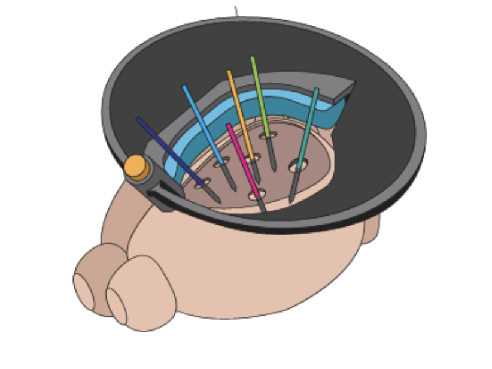
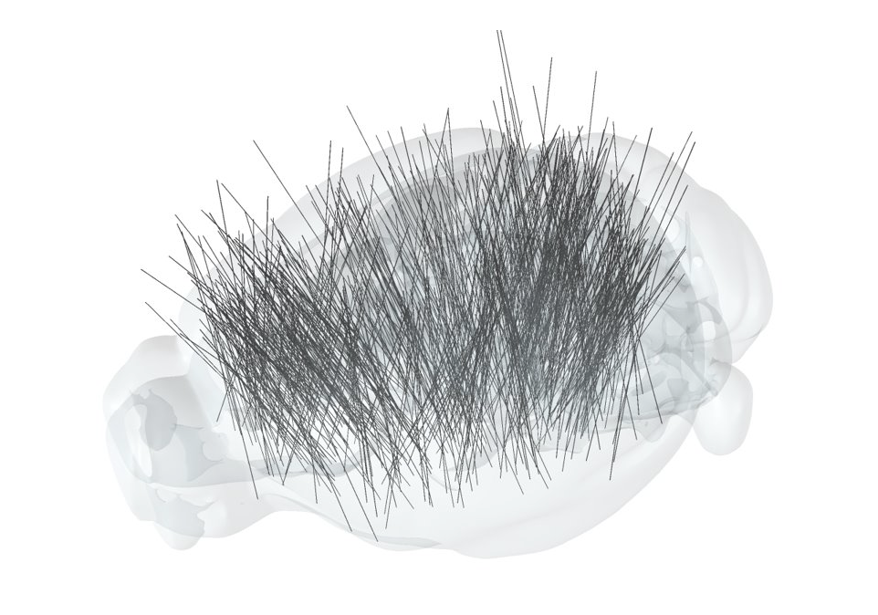
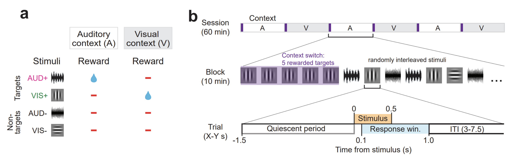

<h1 align="center">CoNECTOME Hackathon</h1>  
<h1 align="center">Allen Institute/Neural Dynamics</h1>  
<h4 align="center"> May 20, 2026 </h4>   
<h4 align="center"> Dynamic Routing</h4> 

## Project overview
The Dynamic Routing project aims to uncover the neural mechanisms of flexible decision making. We train mice to perform a visual–auditory switching task in which the rewarded sensory modality alternates within a session, requiring mice to dynamically route sensory information to appropriate motor outputs depending on behavioral context. While mice perform this task, we record from neurons across the mouse brain to identify the neural correlates of flexible sensory-motor associations and to understand how context representations are generated, maintained, and used to guide behavior.

## Recording strategy
We insert up to six Neuropixels 1.0 (NP 1.0) probes simultaneously across the mouse brain using the **SHIELD implant** ([Bennett et al., *Neuron* 2024](https://doi.org/10.1016/j.neuron.2024.06.015)), a chronic implant system that enables repeatable, multi-probe access to dorsal cortex and underlying structures. Probes are inserted at varying angles and anterior-posterior positions to achieve broad coverage spanning cortical, thalamic, basal ganglia, and midbrain structures (among others). This approach allows us to simultaneously sample the activity of hundreds of neurons across functionally distinct brain regions while the mouse performs our switching task.

---
|  |  |
|---|---|
| *Diagram of SHIELD implant with multiple Neuropixels 1.0 probes.* | *Probe trajectories across mice and sessions showing dense coverage of left hemisphere.* |
---

## Task

Mice perform a **visual-auditory context-switching task** in which the rewarded stimulus modality alternates across blocks within each session.

### Stimuli and Reward Contingencies

Each trial presents one of four stimuli: a visual target (VIS+), a visual non-target (VIS−), an auditory target (AUD+), or an auditory non-target (AUD−). Trials are organized into alternating **auditory-rewarded (A)** and **visual-rewarded (V)** blocks. Within each block, only one target stimulus is rewarded (Figure below, panel **a**):

- **Auditory context (A):** licking in response to AUD+ earns a water reward; licking to VIS+ is a false alarm.
- **Visual context (V):** licking in response to VIS+ earns a water reward; licking to AUD+ a false alarm.

Responses to either non-target stimulus (AUD−, VIS−) are never rewarded regardless of context.

### Session and Block Structure

A session lasts approximately 60 minutes and consists of six ~10-minute blocks alternating between auditory- and visual-rewarded contexts (Figure below, panel **b**). **Context is not explicitly cued on every trial** — the mouse must infer and maintain its representation of the current block from trial outcomes.

Block transitions are signaled by **5 consecutive presentations of the newly rewarded target stimulus** (purple in panel **b**). If the mouse does not earn a contingent reward by licking during these trials, a non-contingent reward is given at the end of the response window. Following these trials, all four stimuli are presented in pseudorandom interleaved order for the remainder of the block.

### Trial Structure

Each trial begins with a **quiescent period** (1.5 s before stimulus onset) during which licking resets the trial. The stimulus is presented for 0.5 s, followed by a **response window** from 0.1–1.0 s post-stimulus onset. The trial concludes with an **inter-trial interval (ITI)** of 3–7.5 s before the next trial begins.


*__a__, Reward contingencies for the auditory (A) and visual (V) contexts. Only the target of the currently rewarded modality yields reward. __b__, Nested timeline of a session (six alternating 10-minute blocks), a block (five rewarded target cue trials followed by pseudo-randomly interleaved stimuli), and a trial (quiescent period, stimulus, response window, ITI).*


## Data in this capsule

This dataset comprises five Neuropixels recording sessions from five different mice, each packaged in a "data asset" in `/data`. 

Each attached asset contains:
- an .nwb file saved as a .hdf5 file or a .zarr folder
- `nwb_contents.json` detailing the internal paths within each .hdf5 file, e.g.:
    ```
    [
        "/intervals/trials",
        "/processing/behavior/running_speed",
        "/units"
    ]   
    ```
- AIND metadata `.json` files


### Summary

All animals successfully switched between contexts, as demonstrated by high d' values for the rewarded modality and suppressed responses to the non-rewarded modality. 
A total of **6,685 QC-passing units** were recorded.

| Session | Subject | Sex | Age | Genotype | Strain | Experiment Day |
|---------|---------|-----|-----|----------|--------|----------------|
| 664851_2023-11-15 | 664851 | F | P310 | Pvalb-IRES-Cre/wt;Ai32 | Pvalb-IRES-Cre;Ai32 | Day 3 |
| 668755_2023-08-31 | 668755 | M | P206 | wt/wt | C57BL6J(NP) | Day 4 |
| 713655_2024-08-09 | 713655 | M | P260 | Sst-IRES-Cre/wt;Ai32 | Sst-IRES-Cre;Ai32 | Day 5 |
| 742903_2024-10-22 | 742903 | F | P159 | Vip-IRES-Cre/wt;Ai32 | Vip-IRES-Cre;Ai32 | Day 2 |
| 759434_2025-02-04 | 759434 | M | P177 | VGAT-ChR2-YFP/wt | VGAT-ChR2-YFP(ND) | Day 2 |

Three of the five mouse lines express channelrhodopsin (ChR2) in specific inhibitory interneuron classes (Pvalb, Sst, Vip, or all GABAergic via VGAT), enabling optotagging of those cell types. One mouse (668755) is wild-type.

---

## Session Structure (Epochs)

Each recording session follows a standardized sequence of epochs:

1. **RFMapping** (~15 min) — Receptive field mapping with visual and auditory stimuli
2. **OptoTagging** (~3–6 min) — Optogenetic identification of genetically-defined neurons (pre-task)
3. **Spontaneous** (~10 min) — Spontaneous activity, no stimuli
4. **SpontaneousRewards** (~10 min) — Spontaneous activity with non-contingent rewards
5. **DynamicRouting1** (~60 min) — Main behavioral task
6. **SpontaneousRewards** (~10 min) — Post-task spontaneous with rewards
7. **OptoTagging** (~3–6 min) — Post-task optotagging (some sessions)
8. **Spontaneous** (~10 min) — Post-task spontaneous (some sessions)

---

### Context Blocks and Rule Switching

The session is divided into **6 blocks** (indices 0–5), alternating between two rewarded-modality contexts:

- **Visual context** (`rewarded_modality = "vis"`): The mouse must lick to visual targets (`vis+` → go) and withhold licking to all other stimuli (including auditory targets `aud+` → no-go).
- **Auditory context** (`rewarded_modality = "aud"`): The mouse must lick to auditory targets (`aud+` → go) and withhold licking to all other stimuli (including visual targets `vis+` → no-go).

Some sessions begin with visual blocks first, others with auditory blocks first. Each modality context has 3 blocks per session.

---

## Trial Structure

Each trial proceeds through the following phases:

1. **Quiescent period** (`quiescent_start_time` → `quiescent_stop_time`): The mouse must remain still (no licking) before a stimulus is presented. Violations restart the quiescent period.
2. **Stimulus presentation** (`stim_start_time` → `stim_stop_time`): A visual grating, auditory stimulus, or catch (blank) is presented.
3. **Response window** (`response_window_start_time` → `response_window_stop_time`): The mouse can lick to report detection. A lick within this window on a go trial is a **hit**; on a no-go trial it is a **false alarm**.
4. **Post-response window** (`post_response_window_start_time` → `post_response_window_stop_time`): Brief post-response period.
5. **Reward** (`reward_time`, if applicable): Water reward delivered on correct go responses (hits) and on some instruction/auto-reward trials.

### Trial Types

| Trial Type | Description |
|------------|-------------|
| **Go** | Target stimulus in the currently rewarded modality; lick = hit, no lick = miss |
| **No-go** | Non-target stimulus, or target in non-rewarded modality; lick = false alarm, no lick = correct reject |
| **Catch** | No stimulus; used to measure baseline lick rate |
| **Instruction** | Auto-rewarded trials (30 per session) at block transitions to cue the new rule |

Additional trial flags: `is_repeat` (repeated after a miss), `is_opto` (optogenetic stimulation applied — 0 opto trials in these task sessions), `is_contingent_reward` / `is_noncontingent_reward`.

---

## Performance Summary

### Overall Trial Counts

| Session | Total Trials | Go | No-go | Catch | Hits | Misses | Correct Rejects | False Alarms | Total Correct | % Correct |
|---------|-------------|-----|-------|-------|------|--------|-----------------|--------------|---------------|-----------|
| 664851 | 534 | 144 | 334 | 56 | 142 | 2 | 282 | 52 | 480 | 89.9% |
| 668755 | 524 | 139 | 329 | 56 | 137 | 2 | 242 | 87 | 430 | 82.1% |
| 713655 | 515 | 136 | 324 | 55 | 129 | 7 | 284 | 40 | 465 | 90.3% |
| 742903 | 538 | 147 | 348 | 43 | 131 | 16 | 317 | 31 | 491 | 91.3% |
| 759434 | 545 | 144 | 353 | 48 | 142 | 2 | 313 | 40 | 502 | 92.1% |

All mice performed well, with overall correct rates ranging from **82–92%** and hit rates consistently high (89–99%).

### d-prime by Rewarded Modality (Block-Averaged)

| Session | Context | Vis d' | Aud d' | Cross-Modal d' | Hit Rate | FA Rate |
|---------|---------|--------|--------|----------------|----------|---------|
| 664851 | vis | 3.54 | −0.74 | 2.53 | 0.99 | 0.15 |
| 664851 | aud | 0.00 | 2.34 | 3.23 | 0.99 | 0.16 |
| 668755 | vis | 3.65 | −0.67 | 1.75 | 0.99 | 0.24 |
| 668755 | aud | −0.83 | 2.64 | 1.95 | 0.98 | 0.30 |
| 713655 | vis | 3.43 | −0.22 | 2.98 | 0.94 | 0.05 |
| 713655 | aud | −0.11 | 1.93 | 2.71 | 0.95 | 0.21 |
| 742903 | vis | 3.15 | −0.11 | 2.04 | 0.82 | 0.07 |
| 742903 | aud | −0.01 | 2.88 | 2.80 | 0.96 | 0.10 |
| 759434 | vis | 3.81 | −0.22 | 3.69 | 0.99 | 0.03 |
| 759434 | aud | −0.10 | 2.48 | 2.50 | 0.98 | 0.20 |

Key observations:
- All mice showed **strong context-dependent discrimination**: high d' for the rewarded modality and near-zero or negative d' for the non-rewarded modality, demonstrating successful task switching.
- **Cross-modal d'** (measuring discrimination between the target of the rewarded modality vs. the target of the non-rewarded modality) was consistently positive (1.75–3.69), confirming that animals selectively responded to the correct modality.
- Hit rates were uniformly high (0.82–0.99). False alarm rates were low to moderate (0.03–0.30), varying across animals and contexts.

---

## Electrophysiology: Recorded Areas (QC-Passing Units Only)

Units were filtered by `is_qc_pass = true`. Each session used 5–6 Neuropixels probes.

### Per-Session Summary

| Session | Total Units | QC-Pass Units | # Probes | # Structures (QC-pass) |
|---------|-------------|---------------|----------|------------------------|
| 664851 | 3,062 | 1,118 | 5 | 22 |
| 668755 | 2,878 | 1,184 | 6 | 28 |
| 713655 | 3,577 | 1,666 | 5 | 20 |
| 742903 | 4,446 | 1,973 | 6 | 22 |
| 759434 | 2,285 | 744 | 5 | 17 |
| **Total** | **16,248** | **6,685** | — | — |

### QC-Passing Units by Brain Area (per session)

#### 664851 (Pvalb-Cre;Ai32)
| Structure | QC-Pass Units |
|-----------|---------------|
| AUDp | 203 |
| MOs | 137 |
| FRP | 108 |
| CA1 | 95 |
| CA3 | 91 |
| ORBvl | 89 |
| VISal | 77 |
| LSc | 54 |
| AUDd | 52 |
| MOB | 43 |
| ACAd | 39 |
| SSp | 28 |
| SSs | 24 |
| ACAv | 23 |
| TEa | 11 |
| VISrl | 10 |
| CA2 | 9 |
| AUDv | 9 |
| ORBl | 6 |
| LSr | 6 |
| OLF | 3 |

#### 668755 (Wild-type C57BL6J)
| Structure | QC-Pass Units |
|-----------|---------------|
| MOs | 241 |
| MOp | 166 |
| ACAv | 153 |
| SSp | 96 |
| CP | 87 |
| VISam | 73 |
| VISp | 57 |
| RSPv | 52 |
| ACAd | 41 |
| AON | 33 |
| ORBl | 32 |
| DP | 18 |
| SCiw | 15 |
| SCig | 13 |
| OLF | 13 |
| TTd | 11 |
| HPF | 11 |
| SCsg | 9 |
| SCdg | 9 |
| PPT | 9 |
| MB | 8 |
| FRP | 7 |
| RSPd | 6 |
| SCop | 5 |
| MPT | 4 |
| PAG | 3 |
| LGv | 3 |
| RSPagl | 3 |
| SCzo | 2 |
| VISpm | 2 |
| SCdw | 1 |
| NOT | 1 |

#### 713655 (Sst-Cre;Ai32)
| Structure | QC-Pass Units |
|-----------|---------------|
| SSs | 271 |
| MOp | 210 |
| ECT | 200 |
| MOs | 188 |
| LSr | 183 |
| CP | 142 |
| TEa | 117 |
| AUDp | 109 |
| AUDv | 77 |
| SSp | 38 |
| VISli | 29 |
| LSc | 28 |
| AUDpo | 23 |
| AD | 17 |
| PERI | 16 |
| AV | 11 |
| ACAd | 7 |

#### 742903 (Vip-Cre;Ai32)
| Structure | QC-Pass Units |
|-----------|---------------|
| MOs | 437 |
| SSp | 324 |
| ORBvl | 250 |
| ILA | 172 |
| SSs | 118 |
| CP | 101 |
| TTd | 96 |
| ORBm | 79 |
| ORBl | 75 |
| ACAd | 67 |
| GU | 54 |
| PL | 53 |
| LSr | 46 |
| ACAv | 31 |
| VISal | 20 |
| FRP | 17 |
| CA1 | 13 |
| OLF | 11 |
| CA3 | 7 |
| DG | 2 |

#### 759434 (VGAT-ChR2-YFP)
| Structure | QC-Pass Units |
|-----------|---------------|
| SSp | 153 |
| MOs | 147 |
| CP | 132 |
| ILA | 62 |
| DP | 59 |
| TTd | 58 |
| CA3 | 50 |
| PL | 46 |
| CA1 | 18 |
| VISli | 5 |
| TEa | 4 |
| ACAd | 3 |
| OLF | 3 |
| DG | 1 |
| ccb | 1 |
| scwm | 1 |
| STR | 1 |

### Commonly Recorded Areas Across Sessions

The most frequently recorded areas with QC-passing units include:

- **Frontal cortex**: MOs (secondary motor), FRP (frontal pole), ACAd/ACAv (anterior cingulate), MOp (primary motor)
- **Somatosensory cortex**: SSp (primary), SSs (supplemental)
- **Prefrontal / orbitofrontal**: ORBvl, ORBl, ORBm, ILA (infralimbic), PL (prelimbic)
- **Visual cortex**: VISp, VISal, VISam, VISrl, VISli, VISpm
- **Auditory cortex**: AUDp (primary), AUDd (dorsal), AUDv (ventral), AUDpo (posterior)
- **Temporal association**: TEa, ECT (ectorhinal), PERI (perirhinal)
- **Hippocampus**: CA1, CA2, CA3, DG
- **Lateral septum**: LSr, LSc
- **Striatum**: CP (caudoputamen)
- **Thalamus**: AD (anterodorsal), AV (anteroventral)
- **Midbrain / superior colliculus**: SCig, SCiw, SCsg, SCop, SCdg, SCzo, SCdw
- **Olfactory**: AON, OLF, TTd, MOB, DP
- **Other**: GU (gustatory), RSPv/RSPd (retrosplenial), PAG, PPT, HPF, MB

---

