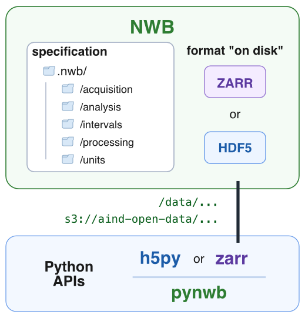
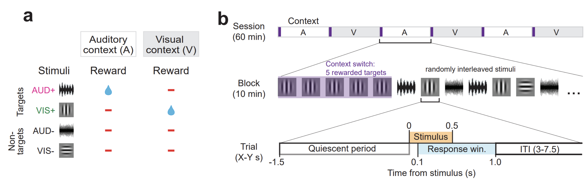
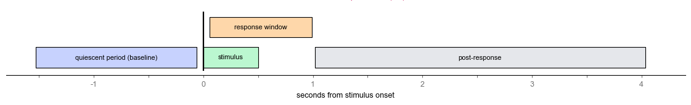
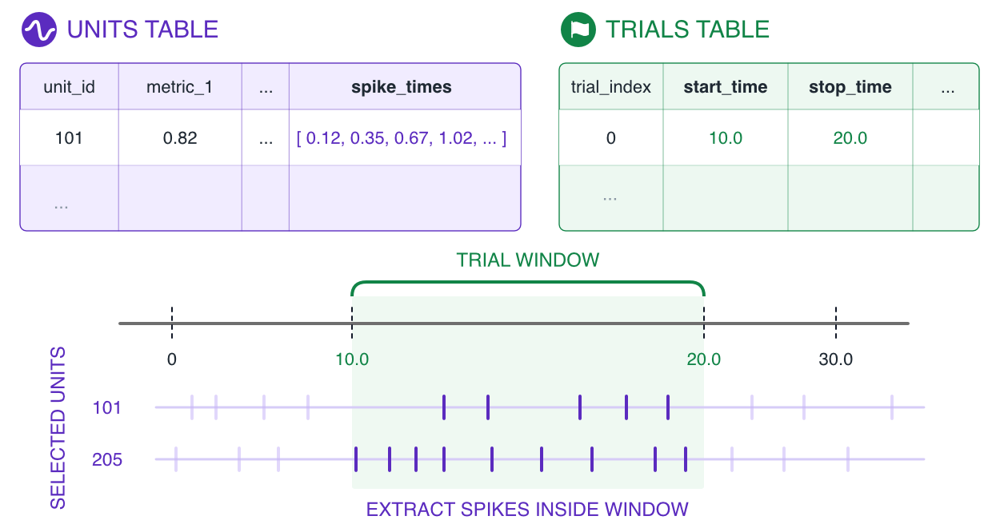
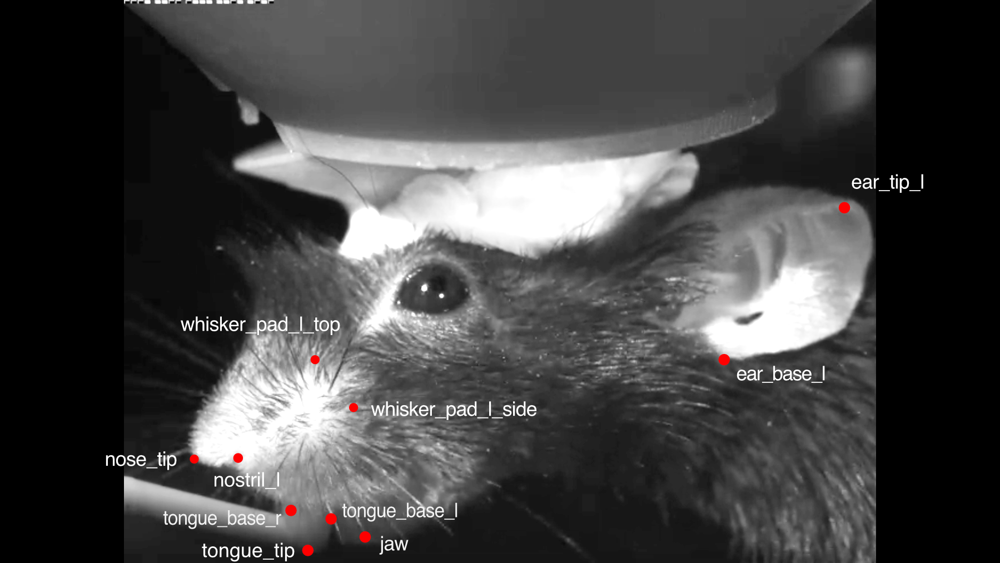

<h1 align="center">Dynamic Routing Data Access Tutorial</h1>
<h3 align="center">Allen Institute / Neural Dynamics</h3>
<h4 align="center">Remote access version</h4>

**Goal:** This tutorial will cover data access, details of the experiment, exploration and scientific analysis.

  We will:
  1. Find & load data packaged as NWB files
  2. Explain the design of the Dynamic Routing task
  3. Visualize task performance
  4. Summarize the brain areas recorded
  5. Explore data around stimulus onset: neural activity, running speed, face motion

For general information about the Dynamic Routing project, see [README.md](../../README.md).

For a description of how the NWB files are organized and what each field contains, see the [NWB file guide](../../resource-files/NWB_FILE_GUIDE.md) and the [data dictionary](../../resource-files/742903_2024-10-23_data_dictionary.md).

---
**This tutorial uses [`lazynwb`](https://pypi.org/project/lazynwb/) to stream the data directly from the public `aind-open-data` S3 bucket**, so it runs on any computer with an internet connection, no AWS credentials required. 

`lazynwb` returns [polars](https://docs.pola.rs/) DataFrames. We convert them to pandas with `.to_pandas()` for this tutorial. 

---


```python
import os
import urllib.request
from pathlib import Path

import lazynwb
import matplotlib.pyplot as plt
import nrrd
import numpy as np
import pandas as pd
import polars as pl
from matplotlib.patches import Patch

lazynwb.config.anon = True   # the bucket is public: no AWS credentials needed

# If you get an UnsafeDecodeError when loading a table, uncomment the two lines below
# (some object-reference columns are stored with the Pickle codec; only do this for files you trust):
# import numcodecs.pickles
# numcodecs.pickles.ALLOW_UNSAFE_PICKLE_DECODE = True
```


```python
# Plot settings 

plt.rcParams.update({
    "figure.figsize": (8, 4),
    "figure.dpi": 110,
    "figure.constrained_layout.use": True,
    "font.size": 15,
    "axes.titlesize": 17,
    "axes.labelsize": 15,
    "xtick.labelsize": 13,
    "ytick.labelsize": 13,
    "legend.fontsize": 12,
    "legend.frameon": False,
    "axes.spines.top": False,
    "axes.spines.right": False,
    "lines.linewidth": 2,
})

CONTEXT_COLORS = {"vis": "#1f77b4", "aud": "#ff7f0e"}   # rewarded modality (and stimulus modality)
STIM_ORDER = ["vis1", "vis2", "sound1", "sound2", "catch"]
STIM_LABELS = {                                           # vis1 and sound1 are the target stimuli
    "vis1": "vis target", "vis2": "vis non-target",
    "sound1": "aud target", "sound2": "aud non-target",
    "catch": "catch",
}


def shade_blocks(ax, trials, start_col="trial_index", stop_col="trial_index", pad=0.5):
    """Shade the background of each block by its rewarded modality."""
    blocks = trials.groupby("block_index").agg(
        start=(start_col, "min"), stop=(stop_col, "max"), modality=("rewarded_modality", "first"))
    for block in blocks.itertuples():
        ax.axvspan(block.start - pad, block.stop + pad, color=CONTEXT_COLORS[block.modality], alpha=0.12, lw=0)


def add_legend(ax, context=True, **kwargs):
    """Legend with the plotted lines plus (optionally) the block-shading colors, placed outside the axes."""
    handles, _ = ax.get_legend_handles_labels()
    if context:
        handles += [Patch(color=c, alpha=0.25, label=f"{m} rewarded") for m, c in CONTEXT_COLORS.items()]
    ax.legend(handles=handles, loc="upper left", bbox_to_anchor=(1.01, 1), **kwargs)
```

---
## 1. Find & open an NWB file 

Every session in the dataset is listed in the metadata table (`dynamic_routing_metadata.csv`). Each row is one recording session and contains information about the subject, recording session, and behavior performance. 

You can use the table to browse for a session or sessions of interest, then use the `subject_id` and `session_date` as search filters to find the corresponding data. 

<details>

<summary>Metadata Details</summary>

The session table below only has the metadata stored inside the NWB files. The complete metadata for each session
is in `.json` files following the [AIND metadata schema](https://github.com/AllenNeuralDynamics/aind-data-schema),
stored in the same bucket folder as the session's NWB file (e.g. `subject.json`, `procedures.json`,
`acquisition.json`, `instrument.json`, `data_description.json`). See below for how to read them.

In Code Ocean, the metadata table `dynamic_routing_metadata.csv` combines a selection of these fields with
behavior performance; it was generated by `/code/dynamic_routing_metadata.ipynb`.

</details>


```python
metadata = pd.read_csv('../../resource-files/dynamic_routing_metadata.csv')
metadata.head()
```

### Data organization
Each session has its own folder in the bucket, which contains the session's NWB file and its metadata `.json` files:

```
s3://aind-open-data/
└── ecephys_<subject ID>_<session date>_<session time>_nwb_<processing date>_<processing time>/
    ├── <subject ID>_<session date>.nwb.zarr
    └── *.json   (metadata)
```

For example, subject 742903, recorded on 2024-10-23:
- folder: `ecephys_742903_2024-10-23_14-12-23_nwb_2026-08-04_15-14-57`
- NWB file: `742903_2024-10-23.nwb.zarr`

You can browse the bucket in a web browser, e.g.
[this session's folder](https://app.quilt.bio/b/aind-open-data/tree/ecephys_742903_2024-10-23_14-12-23_nwb_2026-08-04_15-14-57/).

### Opening an NWB file

We'll select a session from the session table, then open the corresponding NWB file with `lazynwb`.

Instead of attributes like `nwb.trials` (as in `pynwb`), `lazynwb` reads each part of the file by its
**internal path**, e.g. `/intervals/trials` or `/processing/behavior/running_speed`.




```python
S3_PATHS = [
    "s3://aind-open-data/ecephys_708016_2024-04-29_12-59-12_nwb_2026-08-04_15-02-46/708016_2024-04-29.nwb.zarr",
    "s3://aind-open-data/ecephys_741137_2024-10-10_13-15-50_nwb_2026-08-04_15-10-12/741137_2024-10-10.nwb.zarr",
    "s3://aind-open-data/ecephys_715710_2024-07-16_12-58-34_nwb_2026-08-04_15-11-54/715710_2024-07-16.nwb.zarr",
    "s3://aind-open-data/ecephys_713655_2024-08-09_10-41-47_nwb_2026-08-04_15-02-39/713655_2024-08-09.nwb.zarr",
    "s3://aind-open-data/ecephys_714748_2024-06-24_12-52-23_nwb_2026-08-04_15-06-39/714748_2024-06-24.nwb.zarr",
    "s3://aind-open-data/ecephys_759434_2025-02-04_12-27-22_nwb_2026-08-04_15-01-21/759434_2025-02-04.nwb.zarr",
    "s3://aind-open-data/ecephys_742903_2024-10-23_14-12-23_nwb_2026-08-04_15-14-57/742903_2024-10-23.nwb.zarr",
    "s3://aind-open-data/ecephys_664851_2023-11-16_12-54-53_nwb_2026-08-04_15-09-33/664851_2023-11-16.nwb.zarr",
    "s3://aind-open-data/ecephys_662892_2023-08-24_14-28-28_nwb_2026-08-04_15-13-29/662892_2023-08-24.nwb.zarr",
    "s3://aind-open-data/ecephys_712815_2024-05-22_12-26-32_nwb_2026-08-04_14-59-22/712815_2024-05-22.nwb.zarr",
    "s3://aind-open-data/ecephys_743199_2024-12-05_12-42-34_nwb_2026-08-04_15-00-49/743199_2024-12-05.nwb.zarr",
    "s3://aind-open-data/ecephys_667252_2023-09-28_15-00-38_nwb_2026-08-04_15-21-37/667252_2023-09-28.nwb.zarr",
]
```


```python
# Filter the session table for a specific subject and session
session_folder = metadata.query("subject_id == 742903 and session_date == '2024-10-23'")["name"].values[0]

# Find the S3 path whose folder matches the session's folder name
nwb_path = next(path for path in S3_PATHS if path.split("/")[3] == session_folder)
print(nwb_path)

nwb = lazynwb.LazyNWB(nwb_path)   # fast: nothing is downloaded until you ask for data
nwb.session_description
```

Use `lazynwb.get_internal_paths` to list the internal paths of the tables and
timeseries in the file. 


```python
lazynwb.get_internal_paths(nwb_path)
```

---
## 2. Session structure and task design

### Epochs

A session is divided into epochs. The main behavior task is listed as `DynamicRouting1` and runs for ~1 hour. Other epochs record spontaneous behavior (`SpontaneousRewards`) or characterize neurons using receptive field (`RFMapping`) mapping or optogenetic activation (`OptoTagging`). Information about each epoch is stored as a table of intervals with a `start_time` and `stop_time`, at the internal path `/intervals/epochs`.

`lazynwb` adds three columns to every table it loads: `_nwb_path` (the file it came from), `_table_path` and `_table_index` (the row's position in the table). 


```python
epochs = lazynwb.read_nwb(nwb_path, "/intervals/epochs").to_pandas()
epochs
```


```python
fig, ax = plt.subplots(figsize=(11, 2.2))
for color, (name, group) in zip(plt.cm.tab10.colors, epochs.groupby("script_name", sort=False)):
    spans = list(zip(group.start_time, (group.stop_time - group.start_time)))
    ax.broken_barh(spans, (0, 1), color=color, label=name)
ax.set(yticks=[], xlabel="Time in session (s)", title="Epochs")
ax.spines["left"].set_visible(False)
add_legend(ax, context=False)
```

#### Sub-Intervals 
Each epoch may be sub-divided into smaller intervals (e.g. trials) stored in other tables:


```python
epochs.set_index("script_name")["interval_names"]
```

### `DynamicRouting1` task trials

### `trials` table

- accessible at the internal path `/intervals/trials`

- **each row is one trial in the task**

- column types:
    - events (`*_time` suffix) 
        - `float`, seconds relative to start of session
    - boolean metadata (`is_*` prefix)
        - for easy filtering of rows
    - other metadata (`stim_name`, `rewarded_modality`, `block_index`) 
        - `int`, `str`
- column descriptions packaged in the NWB file:

<details>
<summary><b>Trials table column descriptions</b> (click to expand)</summary>

| Column | Description |
| --- | --- |
| start_time | Start time of epoch (s) |
| stop_time | Stop time of epoch (s) |
| quiescent_start_time | Start of pre-stimulus interval in which the subject does not lick; only the last quiescent interval (which was not violated) is included |
| quiescent_stop_time | End of pre-stimulus interval in which the subject does not lick; not equal to `stim_start_time`, which factors in processing and stimulus device latency |
| stim_start_time | Onset of visual or auditory stimulus |
| stim_stop_time | Offset of visual or auditory stimulus |
| response_window_start_time | Start of interval in which the subject should lick if a GO trial, otherwise should not lick |
| response_window_stop_time | End of interval in which the subject should lick if a GO trial, otherwise should not lick |
| task_control_response_time | Time of first lick in trial according to the task control script; nan if no response registered |
| response_time | Time of first lick within the response window; nan if no lick occurred |
| reward_time | Delivery time of water reward, for contingent and non-contingent rewards |
| post_response_window_start_time | Start of null interval in which the subject awaits a new trial |
| post_response_window_stop_time | End of null interval |
| stim_name | The stimulus presented; corresponds to a unique stimulus definition, randomized over trials |
| grating_phase | Phase of the visual grating in cycles; 0 or 0.5 for visual stimuli; nan for auditory stimuli |
| block_index | 0-indexed block number, increments with each block |
| rewarded_modality | Name of the rewarded modality in each block; not an exact correspondence with values in `stim_name` |
| trial_index | 0-indexed trial number |
| trial_index_in_block | 0-indexed trial number within the block |
| repeat_index | Number of times the trial has already been presented in immediately preceding trials; nan for catch trials |
| is_response | The subject licked one or more times during the response window |
| is_correct | The subject acted correctly in the response window; includes correct reject for catch trials |
| is_incorrect | The subject acted incorrectly in the response window; includes false alarm for catch trials |
| is_hit | The subject responded in a GO trial |
| is_false_alarm | The subject responded in a NOGO trial; excludes catch trials |
| is_correct_reject | The subject did not respond in a NOGO trial; excludes catch trials |
| is_miss | The subject did not respond in a GO trial |
| is_go | Condition in which the subject should respond; target stim presented in rewarded block |
| is_nogo | Condition in which the subject should not respond; excludes catch trials |
| is_rewarded | The subject received a reward; includes non-contingent rewards |
| is_noncontingent_reward | The subject received a reward that did not depend on its response |
| is_contingent_reward | The subject received a reward for a correct response |
| is_reward_scheduled | A non-contingent reward was scheduled to occur regardless of whether it was delivered |
| is_instruction | Stimulus specifically chosen to inform the subject of a change in rewarded modality |
| is_aud_stim | An auditory stimulus was presented; excludes catch trials |
| is_vis_stim | A visual stimulus was presented; excludes catch trials |
| is_catch | No stimulus was presented |
| is_target | A stimulus was presented that the subject should respond to only in a specific block |
| is_aud_target | An auditory stimulus the subject should respond to only in a specific block |
| is_vis_target | A visual stimulus the subject should respond to only in a specific block |
| is_nontarget | A stimulus the subject should never respond to |
| is_aud_nontarget | An auditory stimulus the subject should never respond to |
| is_vis_nontarget | A visual stimulus the subject should never respond to |
| is_vis_rewarded | Visual target stimuli are rewarded |
| is_aud_rewarded | Auditory target stimuli are rewarded |
| is_block_switch | The first trial with a stimulus after a change in rewarded modality |
| is_repeat | The trial is a repetition of the previous trial due to a miss |
| is_opto | Optogenetic inactivation was applied during the trial |
| is_task_control_correct | The task control script interpreted the subject's response correctly; where False, `is_hit` or `is_miss` may be incorrect |

</details>


```python
trials = lazynwb.read_nwb(nwb_path, "/intervals/trials").to_pandas()
trials.head()
```

### Session overview

The 4 stimuli and catch trials are presented in random order. The rewarded modality switches between blocks, so vis target (vis+) is only rewarded during the visual block and aud target (aud+) is only rewarded during the auditory block. 



Plot description: each tick mark represents one trial. Black ticks indicate whether the mouse licked during the response window. Grey ticks mean the stimulus was presented and the mouse did not lick, which is the correct choice for non-rewarded stimuli. The background color indicates the rewarded modality - blue is the visual target and orange is the auditory target. 


```python
def plot_trials_overview(ax, trials):
    stims = [s for s in STIM_ORDER if s in set(trials.stim_name)]
    row = trials.stim_name.map({s: i for i, s in enumerate(stims)})
    shade_blocks(ax, trials)
    for licked, color, label in [(False, "0.8", "no lick"), (True, "black", "lick")]:
        is_sel = trials.is_response == licked
        ax.scatter(trials.trial_index[is_sel], row[is_sel], marker="|", s=150, lw=1.5, color=color, label=label)
    ax.set_yticks(range(len(stims)), [STIM_LABELS.get(s, s) for s in stims])
    ax.set_ylim(len(stims) - 0.5, -0.5)
    ax.set_xlabel("Trial")
    add_legend(ax)


fig, ax = plt.subplots(figsize=(14, 3.5))
plot_trials_overview(ax, trials)
ax.set_title("Session overview")
```

Zoom in on the first block switch:

> 💡 
> 
> The first five trials in a block (instruction trials) have a non-contingent reward scheduled - if the mice fail to lick during the response window, they still receive a reward, unexpectedly. 
>
> We'll see later how quickly they update their behavior after the block switch.


```python
first_switch = trials.query("block_index == 1").trial_index.min() # finds the trial index of the first block switch (0 to 1)

fig, ax = plt.subplots(figsize=(14, 3.5))
plot_trials_overview(ax, trials)
ax.set_xlim(first_switch - 20, first_switch + 30) # set x-axis limits to show 20 trials before and 30 trials after the first block switch 
ax.set_title("Block switch")
```

### Timing within a trial
All times in the NWB file are in seconds relative to the start of the session.
To get response latency, subtract the stimulus onset time in each trial.



> 💡 Responses to auditory stimuli are faster than to visual stimuli: phototransduction is slow
> compared to mechanotransduction.


```python
trials["response_latency"] = trials.response_time - trials.stim_start_time

fig, ax = plt.subplots(figsize=(7, 4))
bins = np.arange(0, 1.0, 0.025)
for modality, stim in [("vis", "vis1"), ("aud", "sound1")]:
    latency = trials.query("stim_name == @stim").response_latency.dropna()
    ax.hist(latency, bins=bins, color=CONTEXT_COLORS[modality], alpha=0.7, label=STIM_LABELS[stim])
ax.set(xlabel="Response latency (s)", ylabel="Trials", title="Lick latency")
ax.legend()
```

---
## 3. Task performance

Boolean columns in the trials table describe each trial's outcome: `is_response`, `is_hit`, `is_miss`,
`is_false_alarm`, `is_correct_reject`, ...

The NWB file also has a pre-computed `performance` table with outcomes aggregated per block. 

<details>
<summary><b>Performance table column descriptions</b> (click to expand)</summary>

| Column | Description |
| --- | --- |
| start_time | Start time of epoch (s) |
| stop_time | Stop time of epoch (s) |
| block_index | Presentation position of the block in the task (0-indexed) |
| n_trials | The number of trials in the block |
| n_responses | The number of responses the subject made in trials in the block |
| n_hits | The number of correct responses the subject made in GO trials in the block (excluding trials with scheduled reward) |
| n_contingent_rewards | The number of rewards the subject received for correct responses in the block |
| hit_rate | The proportion of correct responses the subject made in GO trials in the block (excluding trials with scheduled reward) |
| false_alarm_rate | The proportion of incorrect responses the subject made in NOGO trials in the block |
| catch_response_rate | The proportion of responses the subject made in catch trials in the block |
| rewarded_modality | The modality of the target stimulus that was rewarded in the block: normally `vis` or `aud` |
| is_first_block_aud | Whether the rewarded modality of the first block in the task was auditory |
| cross_modality_dprime | dprime across modalities; hits=response rate to rewarded target stimulus, false alarms=response rate to non-rewarded target stimulus |
| signed_cross_modality_dprime | Same as `cross_modality_dprime` but with negative values for auditory blocks |
| vis_dprime | dprime within visual modality; hits=response rate to visual target stimulus, false alarms=response rate to visual non-target stimulus |
| aud_dprime | dprime within auditory modality; hits=response rate to auditory target stimulus, false alarms=response rate to auditory non-target stimulus |
| vis_target_response_rate | The proportion of responses the subject made to visual target stimulus trials in the block (excluding trials with scheduled reward) |
| vis_nontarget_response_rate | The proportion of responses the subject made to visual nontarget stimulus trials in the block (excluding trials with scheduled reward) |
| aud_target_response_rate | The proportion of responses the subject made to auditory target stimulus trials in the block (excluding trials with scheduled reward) |
</details>


```python
performance = lazynwb.read_nwb(nwb_path, "/intervals/performance").to_pandas()
performance
```

> 💡 The mouse responds to the target of the rewarded modality and withholds responses to the other target,
> flipping back and forth across blocks.


```python
fig, ax = plt.subplots(figsize=(8, 4))
shade_blocks(ax, trials, "block_index", "block_index")
for modality in ["vis", "aud"]:
    ax.plot(performance.block_index, performance[f"{modality}_target_response_rate"],
            "o-", ms=8, color=CONTEXT_COLORS[modality], label=f"{modality} target")
ax.set(xlabel="Block", ylabel="Response rate", ylim=(-0.05, 1.05),
       xticks=performance.block_index, title="Performance by block")
add_legend(ax)
```

#### Misses after a block switch
Misses (no lick to the rewarded target) in the first 15 trials of each block:

> 💡 
> 
> Once the mice learn the task, they typically only need one "miss" on the first trial of a block to update their behavior, and make very few misses in the rest of the block.


```python
miss_grid = (
    trials.query("trial_index_in_block < 15")
    .pivot_table(index="block_index", columns="trial_index_in_block", values="is_miss", aggfunc="max")
)

fig, ax = plt.subplots(figsize=(8, 3.5))
ax.imshow(miss_grid.to_numpy(dtype=float), cmap="Greys", vmin=0, vmax=1.5, aspect="auto")
ax.set(xticks=range(miss_grid.shape[1]), yticks=range(miss_grid.shape[0]),
       xlabel="Trial in block", ylabel="Block", title="Misses in first 15 trials of each block")
plt.show()
```

---
## 4. Neural data

### `units` table
- **each row is one recorded (putative) neuron from spike-sorting**

- metadata about each unit

- list-like `spike_times` and `spike_amplitudes` columns

- array-like `waveform_mean` and `waveform_sd` columns, which are very large compared to the scalar metadata (excluded from these NWB files)

With `lazynwb`, you can scan the units table to output a lazy polars `LazyFrame`. We'll load in the units table without the large array data for efficiency. Let's load the units dataframe without the unnecessary columns:


<details>
<summary><b>Units table column descriptions</b> (click to expand)</summary>

| Column | Description |
| --- | --- |
| activity_drift | Measure of drift in unit activity over the session |
| amplitude | Amplitude (µV) of the average spike waveform |
| amplitude_cutoff | Estimated fraction of spikes missing from this unit (default threshold = 0.1) |
| amplitude_cv_median | Median coefficient of variation of spike amplitudes |
| amplitude_cv_range | Range of coefficient of variation of spike amplitudes |
| amplitude_median | Median spike amplitude (µV) |
| ccf_ap | Anterior-posterior coordinate in Allen CCF atlas (µm) |
| ccf_dv | Dorsal-ventral coordinate in Allen CCF atlas (µm) |
| ccf_ml | Medial-lateral coordinate in Allen CCF atlas (µm) |
| cluster_id | Identifier for this unit assigned by the spike sorting algorithm (unique within each probe) |
| d_prime | Measure of how separable this unit's waveforms are from its neighbors' |
| decoder_label | Predicted cell type label from decoder |
| decoder_probability | Confidence of decoder cell type prediction [0-1] |
| default_qc | Whether the unit passes default quality control criteria |
| device_name | Name of the recording device |
| drift_mad | Median absolute deviation of unit drift |
| drift_ptp | Peak-to-peak amplitude of unit drift (µm) |
| drift_std | Standard deviation of unit drift |
| electrode_group_name | Name of the electrode group the unit was recorded from |
| exp_decay | Exponential decay of the autocorrelogram |
| firing_range | Range of firing rates across the session |
| firing_rate | Mean spike rate across the whole session (Hz) |
| half_width | Half-width of the mean spike waveform (s) |
| is_not_drift | Boolean indicating unit is not classified as a drift artifact |
| is_qc_pass | Boolean indicating unit passes quality control |
| isi_violations_count | Number of inter-spike interval violations (<1.5 ms) |
| isi_violations_ratio | Measure of unit contamination from refractory period violations (default threshold = 0.5) |
| isolation_distance | Distance to nearest cluster in Mahalanobis space; higher is better |
| l_ratio | Measure of how separable this unit's waveforms are from its neighbors'; lower is better |
| location | brain structure (acronym) |
| nn_hit_rate | Fraction of spikes with nearest neighbor from same cluster |
| nn_miss_rate | Measure of fraction of spikes missing from this unit |
| num_negative_peaks | Number of negative peaks in the mean spike waveform |
| num_positive_peaks | Number of positive peaks in the mean spike waveform |
| num_spikes | Total number of spikes detected for the unit |
| peak_channel | Channel index with the largest amplitude waveform |
| peak_electrode | Electrode index with the largest amplitude spike waveform |
| peak_to_valley | Time (s) between waveform peak and trough |
| peak_trough_ratio | Peak-to-trough ratio of the average spike waveform |
| presence_ratio | Fraction of the session over which this unit had spikes detected (default threshold = 0.9) |
| recovery_slope | Slope of the waveform between the trough and the peak (V/s) |
| repolarization_slope | Slope of the waveform back to 0 after the peak (V/s) |
| rp_contamination | Estimated contamination from refractory period violations |
| rp_violations | Number of refractory period violations |
| silhouette | Measure of unit contamination based on cluster separation |
| sliding_rp_violation | Sliding refractory period violation metric |
| snr | Ratio of waveform amplitude relative to background noise on the peak channel |
| spike_amplitudes | Array of individual spike amplitudes (µV) |
| spread | Distance the waveform extends above and below the peak channel (µm) |
| structure | Brain structure acronym where the unit was recorded |
| sync_spike_2 | Synchrony of unit spikes within 2 ms windows |
| sync_spike_4 | Synchrony of unit spikes within 4 ms windows |
| sync_spike_8 | Synchrony of unit spikes within 8 ms windows |
| unit_id | Unique UUID identifier for the unit |
| velocity_above | Speed of waveform propagation above the peak channel (V/s) |
| velocity_below | Speed of waveform propagation below the peak channel (V/s) |
| spike_times | Timestamps (s) of each detected spike for the unit |
| obs_intervals | Time intervals during which the unit was observed/recorded |
| electrode_group | The electrode group that each spike unit came from |

</details>


```python
units_lf = lazynwb.scan_nwb(nwb_path, "/units")   # lazy: nothing downloaded yet

# Download all columns except the large array columns and object references
units = (
    units_lf
    .select(pl.exclude("spike_times", "spike_amplitudes", "obs_intervals", "electrode_group"))
    .collect()
    .to_pandas()
)
units[["unit_id", "structure", "location", "firing_rate", "num_spikes", "is_qc_pass"]].head()
```

`is_qc_pass` allows quick filtering for units whose activity is stable over the task and that don't look like noise:
- `activity_drift < 0.1`
- `amplitude_cutoff <= 0.1`
- `presence_ratio > 0.7`
- `decoder_label != "noise"`

### Where were units recorded?
- `structure` is the coarse brain area label
- `location` is the more specific label, matching `acronym` in the Allen CCF ontology


```python
area_counts = pd.DataFrame({
    "all units": units.structure.value_counts(),
    "passing QC": units.query("is_qc_pass").structure.value_counts(),
}).fillna(0).astype(int).sort_values("all units")

fig, ax = plt.subplots(figsize=(7, 0.28 * len(area_counts) + 1.5))
ax.barh(area_counts.index, area_counts["all units"], color="0.8", label="all units")
ax.barh(area_counts.index, area_counts["passing QC"], color="0.3", label="passing QC")
ax.set(xlabel="Units", title="Units per brain area")
ax.tick_params(axis="y", labelsize=11)
ax.legend(loc="lower right")
```

Probe insertion tracks are manually annotated and warped to a reference brain, so every recording site has
coordinates in a common space across subjects (the Allen CCF, in µm). More info: https://allenswdb.github.io/background/CCF.html

Each site below is colored with the standard Allen atlas color for its brain area.

> 💡 The physical probes are straight, but appear wobbly due to the warping into the CCF.


```python
CCF_URL = "https://raw.githubusercontent.com/cortex-lab/allenCCF/refs/heads/master/structure_tree_safe_2017.csv"
ccf_tree = pd.read_csv(CCF_URL, usecols=["acronym", "name", "color_hex_triplet"]).drop_duplicates("acronym")
AREA_COLORS = dict(zip(ccf_tree.acronym, "#" + ccf_tree.color_hex_triplet.astype(str).str.zfill(6)))

sites = units.dropna(subset=["ccf_ap", "ccf_dv", "ccf_ml"]).query("decoder_label != 'noise'")

def plot_sites(ax_sagittal, ax_coronal, sites):
    for structure, group in sites.groupby("structure"):
        color = AREA_COLORS.get(structure, "#999999")
        ax_sagittal.scatter(group.ccf_ap / 1000, group.ccf_dv / 1000, s=12, color=color, ec="none", label=structure)
        ax_coronal.scatter(group.ccf_ml / 1000, group.ccf_dv / 1000, s=12, color=color, ec="none")
    ax_sagittal.set(xlabel="Anterior → posterior (mm)", ylabel="Dorsal → ventral (mm)", title="Side view")
    ax_coronal.set(xlabel="Medial-lateral (mm)", title="Front view")
    for ax in (ax_sagittal, ax_coronal):
        ax.set_aspect("equal")
        if not ax.yaxis_inverted():
            ax.invert_yaxis()   # dorsal at the top
```


```python
# downloads the Allen CCFv3 25 µm annotation volume the first time it runs
ATLAS_URL = ("https://download.alleninstitute.org/informatics-archive/current-release/"
             "mouse_ccf/annotation/ccf_2017/annotation_25.nrrd")
atlas_path = os.path.expanduser("~/annotation_25.nrrd")
if not os.path.exists(atlas_path) or os.path.getsize(atlas_path) < 1_000_000:
    urllib.request.urlretrieve(ATLAS_URL, atlas_path)

annotation, _ = nrrd.read(atlas_path)   # axes: AP, DV, ML
res_mm = 25 / 1000

n_ap, n_dv, n_ml = annotation.shape
in_brain = annotation > 0

fig, (ax_sag, ax_cor) = plt.subplots(1, 2, figsize=(14, 5), sharey=True,
                                     gridspec_kw={"width_ratios": [n_ap, n_ml]})
ax_sag.imshow(in_brain.any(axis=2).T, cmap="Greys", vmax=8,
              extent=[0, n_ap * res_mm, n_dv * res_mm, 0])
ax_cor.imshow(in_brain.any(axis=0), cmap="Greys", vmax=8,
              extent=[0, n_ml * res_mm, n_dv * res_mm, 0])
plot_sites(ax_sag, ax_cor, sites)
fig.legend(loc="outside right upper", ncols=2, fontsize=10, markerscale=1.5)
```

### A single unit

Choose a unit by its `unit_id`, or pick one with a query on the units table.


```python
UNIT_ID = "742903_2024-10-23_F-178"

# or pick a random unit that passes QC in an area of interest:
# UNIT_ID = units.query("is_qc_pass and structure == 'MOp' and firing_rate > 5").sample(1).unit_id.iloc[0]

unit = units.set_index("unit_id").loc[UNIT_ID]

# download the spike times of this one unit only
spike_times = (
    units_lf
    .filter(pl.col("unit_id") == UNIT_ID)
    .select("spike_times")
    .collect()["spike_times"][0]
    .to_numpy()
)   # seconds, sorted
unit[["structure", "location", "electrode_group_name", "firing_rate", "is_qc_pass"]]
```

### Spikes around one trial
`spike_times` covers the whole session. To relate spikes to the task, take the spikes in a window around a
trial's stimulus onset and subtract the onset time.




```python
trial = trials.query("stim_name == 'sound1' and is_hit").iloc[0]
onset = trial.stim_start_time
spikes_in_trial = spike_times[(spike_times > onset - 1) & (spike_times < onset + 2)] - onset

response_window = (
    (trials.response_window_start_time - trials.stim_start_time).median(),
    (trials.response_window_stop_time - trials.stim_start_time).median(),
)

fig, ax = plt.subplots(figsize=(10, 1.8))
ax.axvspan(*response_window, color="0.92", lw=0, label="response window")
ax.eventplot(spikes_in_trial, colors="black", linelengths=0.8, linewidths=1.5)
ax.axvline(0, color="0.5", ls="--", lw=1)
ax.plot(trial.response_time - onset, 0.6, "v", color="black", ms=10, label="lick")
ax.set(yticks=[], xlabel="Time from stimulus onset (s)", title=f"One trial ({STIM_LABELS['sound1']})")
ax.spines["left"].set_visible(False)
add_legend(ax, context=False)
```

### Raster and PSTH
Stack many trials of the same stimulus (raster), then average the spike counts in small time bins
to get the firing rate (peri-stimulus time histogram, PSTH). Here trials are split by block type.

> 💡 This unit responds to the auditory target regardless if it's rewarded or not. 


```python
def align_spikes(spike_times, event_times, window):
    """List of spike-time arrays, one per event, relative to the event time."""
    starts = np.searchsorted(spike_times, event_times + window[0])
    stops = np.searchsorted(spike_times, event_times + window[1])
    return [spike_times[a:b] - t for a, b, t in zip(starts, stops, event_times)]


def plot_raster_psth(ax_raster, ax_psth, spike_times, trials, stim_name, window=(-1, 2), bin_size=0.025):
    bins = np.arange(window[0], window[1] + bin_size, bin_size)
    first_row = 0
    for modality, color in CONTEXT_COLORS.items():
        context_trials = trials.query("stim_name == @stim_name and rewarded_modality == @modality")
        if context_trials.empty:
            continue
        aligned = align_spikes(spike_times, context_trials.stim_start_time.to_numpy(), window)
        rows = first_row + np.arange(len(aligned))
        ax_raster.eventplot(aligned, lineoffsets=rows, linelengths=1, linewidths=0.6, colors=color)
        ax_raster.scatter(context_trials.response_time - context_trials.stim_start_time, rows,
                          s=5, color="black", zorder=3)   # first lick (if any)
        rate = sum(np.histogram(s, bins)[0] for s in aligned) / len(aligned) / bin_size
        ax_psth.plot(bins[:-1] + bin_size / 2, rate, color=color, label=f"{modality} rewarded")
        first_row += len(aligned)

    for ax in (ax_raster, ax_psth):
        ax.axvspan(*response_window, color="0.92", lw=0, zorder=-1)
        ax.axvline(0, color="0.5", ls="--", lw=1)
    ax_raster.set(xlim=window, ylim=(first_row, -1), ylabel="Trial", title=STIM_LABELS.get(stim_name, stim_name))
    ax_psth.set(xlabel="Time from stimulus onset (s)", ylabel="Spikes/s")


fig, (ax_raster, ax_psth) = plt.subplots(2, 1, figsize=(7, 7), sharex=True, height_ratios=[3, 1.2])
plot_raster_psth(ax_raster, ax_psth, spike_times, trials, "sound1")
fig.suptitle(f"{UNIT_ID} ({unit.location})", fontsize=13)
add_legend(ax_psth, context=False)
```

#### All four stimuli 


```python
stims = ["vis1", "sound1", "vis2", "sound2"]
fig, axes = plt.subplots(2, len(stims), figsize=(16, 7), sharex=True, height_ratios=[3, 1.2])
for (ax_raster, ax_psth), stim in zip(axes.T, stims):
    plot_raster_psth(ax_raster, ax_psth, spike_times, trials, stim)
    ax_psth.sharey(axes[1, 0])   # same firing-rate scale in every PSTH
for ax in axes[:, 1:].flat:
    ax.set_ylabel("")
fig.suptitle(f"{UNIT_ID} ({unit.location})", fontsize=13)
add_legend(axes[1, -1], context=False)
```

---
## 5. Continuous behavior

### Running speed
Timeseries are stored under `/processing/behavior`, with a `data` array and matching `timestamps`. `lazynwb.get_timeseries` gives access to both; the arrays are downloaded when you index them (`[:]`).


```python
running_speed = lazynwb.get_timeseries(nwb_path, "/processing/behavior/running_speed", exact_path=True)
rs_times = np.asarray(running_speed.timestamps[:])
rs_speed = np.asarray(running_speed.data[:])

# drop samples without a valid timestamp
is_valid = np.isfinite(rs_times)
rs_times, rs_speed = rs_times[is_valid], rs_speed[is_valid]

print(f"{len(rs_times)} samples at {1 / np.median(np.diff(rs_times)):.0f} Hz, in {running_speed.unit}")
```

Running speed for 3 minutes on either side of the first block switch:


```python
switch_time = trials.query("block_index == 1").start_time.min()
in_window = np.abs(rs_times - switch_time) < 180

fig, ax = plt.subplots(figsize=(13, 3.5))
shade_blocks(ax, trials, "start_time", "stop_time", pad=0)
ax.plot(rs_times[in_window], rs_speed[in_window], color="black", lw=1)
ax.set(xlim=(switch_time - 180, switch_time + 180), xlabel="Time in session (s)",
       ylabel=f"Speed ({running_speed.unit})", title="Running speed")
add_legend(ax)
```

### Running speed around stimulus onset
To compare across trials, sample the signal on a common time grid around each stimulus onset, then average.
The same two helpers work for any continuous signal.

> 💡 Running speed appears to be higher during auditory-rewarded blocks. Is this consistent across subjects?


```python
def align_to_events(times, values, event_times, window=(-1.5, 2.0), step=0.05):
    """Sample a continuous signal around each event. Returns (time grid, trials x time array)."""
    grid = np.arange(window[0], window[1], step)
    in_range = (event_times + window[0] >= times[0]) & (event_times + window[1] <= times[-1])
    return grid, np.array([np.interp(t + grid, times, values) for t in event_times[in_range]])


def plot_mean_by_context(ax, times, values, trials):
    """Mean ± SEM of a signal around stimulus onset, one line per block type."""
    for modality, color in CONTEXT_COLORS.items():
        onsets = trials.query("rewarded_modality == @modality").stim_start_time.to_numpy()
        grid, traces = align_to_events(times, values, onsets)
        mean, sem = traces.mean(axis=0), traces.std(axis=0, ddof=1) / np.sqrt(len(traces))
        ax.plot(grid, mean, color=color, label=f"{modality} rewarded (n={len(traces)})")
        ax.fill_between(grid, mean - sem, mean + sem, color=color, alpha=0.25, lw=0)
    ax.axvline(0, color="0.5", ls="--", lw=1)
    ax.set_xlabel("Time from stimulus onset (s)")
    ax.legend()


# target trials with a correct outcome
target_trials = trials.query("(is_vis_target or is_aud_target) and (is_hit or is_correct_reject)")
outcomes = {"Hits": "is_hit", "Correct rejects": "is_correct_reject"}

fig, axes = plt.subplots(1, 2, figsize=(12, 4), sharey=True)
for ax, (title, column) in zip(axes, outcomes.items()):
    plot_mean_by_context(ax, rs_times, rs_speed, target_trials.query(column))
    ax.set_title(title)
axes[0].set_ylabel(f"Speed ({running_speed.unit})")
```

### Face tracking with Lightning Pose
Markerless pose estimation with deep learning tracks keypoints on the face in the side camera video.




```python
lp_columns = list(lazynwb.get_table_schema(nwb_path, "/processing/behavior/lp_side_camera", exclude_internal_columns=True))
lp_columns
```

Each keypoint has a likelihood score. Check its distribution and drop low-confidence detections.
Load only the columns you need: the full table is large.


```python
KEYPOINT = "ear_base_l_y"
likelihood_col = KEYPOINT[:-2] + "_likelihood"

lp = (
    lazynwb.scan_nwb(nwb_path, "/processing/behavior/lp_side_camera")
    .select("timestamps", KEYPOINT, likelihood_col)   # download only these columns
    .collect()
    .to_pandas()
    .dropna(subset=["timestamps"])                    # drop frames without a valid timestamp
)

fig, ax = plt.subplots(figsize=(6, 3))
ax.hist(lp[likelihood_col], bins=50, color="0.4")
ax.axvline(0.9, color="black", ls="--", lw=1)
ax.set(xlabel="Likelihood", ylabel="Frames", title=KEYPOINT[:-2])
```

> 💡 The ear sits slightly higher during auditory-rewarded blocks, even before stimulus onset!


```python
lp_good = lp.query(f"{likelihood_col} > 0.9")

fig, axes = plt.subplots(1, 2, figsize=(12, 4), sharey=True)
for ax, (title, column) in zip(axes, outcomes.items()):
    plot_mean_by_context(ax, lp_good.timestamps.to_numpy(), lp_good[KEYPOINT].to_numpy(), target_trials.query(column))
    ax.set_title(title)
axes[0].set_ylabel("Ear position (pixels)")
axes[0].invert_yaxis()   # image coordinates: y increases downward, so up is up
```
